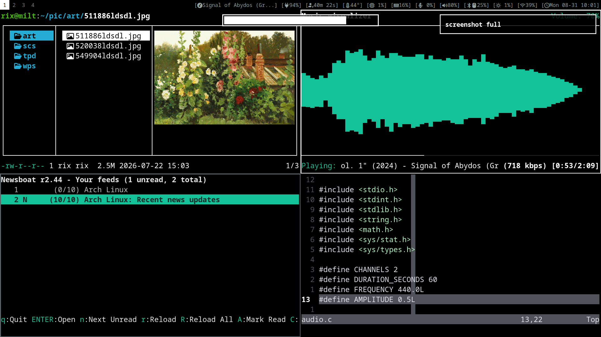

# dotfiles



<p align="center">
  <a href="./README.md">English</a> |
  <a href="./README_zh.md">简体中文</a>
</p>

> [!NOTE]
> - Minimalist
> - Keyboard-driven
> - Rolling updates

## [Arch Linux](https://archlinux.org) and [Sway](https://swaywm.org)
I use Arch Linux and Sway as my operating system and desktop environment. Arch Linux is a minimalist and pragmatic operating system. It does not provide an out-of-the-box experience and requires you to configure most things yourself, which is very interesting for DIY users. Sway is the Wayland port of i3 under Xorg. It is easy to configure and largely compatible with i3 configurations, so you can try copying your i3 configuration directly to Sway.

## Install Arch Linux
You can refer to my Arch Linux [installation](./arch_install.md) habits.

## Software I Use
```sh
cat pkgs.list | less
```

| | |
|:---|:---|
| Operating system | Arch Linux |
| Script interpreter | bash |
| Display protocol | wayland |
| Desktop environment | sway |
| Terminal | foot |
| Text editor | neovim |
| File manager | lf |
| Status bar | i3status-rust |
| Input method | fcitx5 |
| Audio service | pipewire |
| Audio management | wiremix |
| Bluetooth management | bluetui |
| Screen backlight control | brightnessctl  -  ddcutil |
| Screenshot | grim  -  slurp |
| Progress bar | wob |
| Notifications | mako  -  libnotify |
| System monitoring | btop |
| Network management | networkmanager |
| Firewall | ufw |
| Browser | librewolf  -  w3m |
| RSS subscription | newsboat |
| Music player | ncmpcpp  -  mpc  -  mpd |
| Video player | mpv |
| Image viewing | swayimg |
| Screen recording | wf-recorder |
| Virtualization | libvirt  -  qemu-base  -  virt-manager |
| Keyboard mapping | keyd |
| Fonts | noto-fonts-cjk  -  ttf-nerd-fonts-symbols-mono |
| Local AI | ollama |
| AI agent | openai-codex |
| Configuration file management | stow |
| File sync | rsync |
| Android debugging | android-tools  -  scrcpy |
| Android file transfer | android-file-transfer |
| Code management | git |
| File compression and extraction | ouch |
| Power management | tlp |
| Clipboard | wl-clipboard |
| Secure Boot | sbctl |
| Wallpaper | swaybg |
| Lock screen | swaylock |
| Sleep | swayidle |
| Typing | ttyper |
| Launcher | wmenu |
| QR code scanning | zbar |
| Sandbox apps | flatpak |

## License
[GNU GPL v3.0](./LICENSE)
```sh
# @author bin
```
