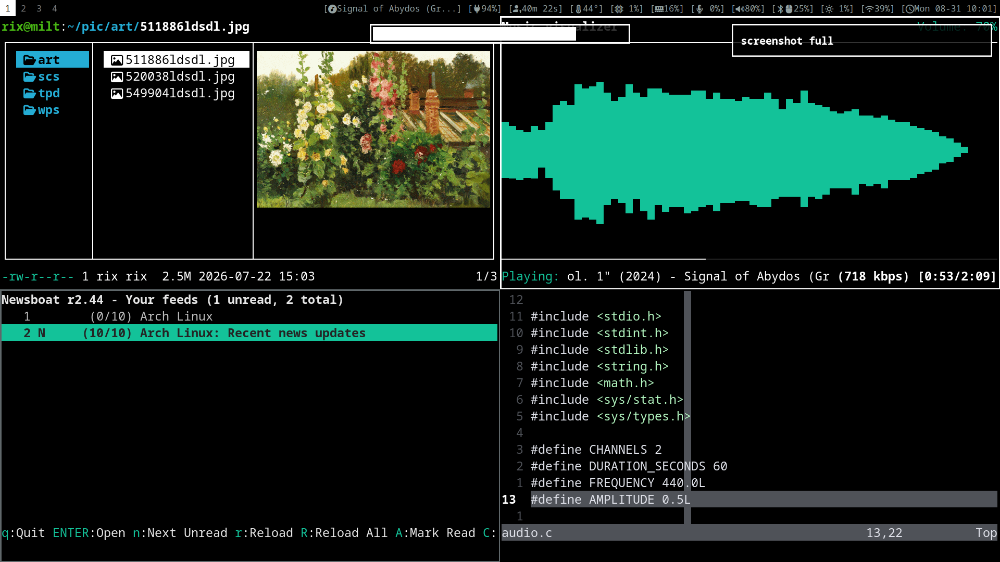

# dotfiles



<p align="center">
  <a href="./README.md">English</a> |
  <a href="./README_zh.md">简体中文</a>
</p>

> [!NOTE]
> - 极简主义
> - 键盘操作
> - 滚动更新

## [Arch Linux](https://archlinux.org) 与 [Sway](https://swaywm.org)
我使用archlinux与sway作为操作系统与桌面环境。archlinux是极简与实用主义的操作系统，它不提供开箱即用的体验，需要自行配置大部分东西，这对于diy用户非常有意思。sway是xorg下i3的wayland迁移，配置友好，与i3的配置基本通用，可以尝试直接将i3的配置复制到sway。

## 安装 Arch Linux
参考我的archlinux[安装](./arch_install_zh.md)习惯

## 我使用的软件
```sh
cat pkgs.list | less
```

| | |
|:---|:---|
| 操作系统 | Arch Linux |
| 脚本解释器 | bash |
| 显示协议 | wayland |
| 桌面环境 | sway |
| 终端 | foot |
| 文本编辑 | neovim |
| 文件管理 | lf |
| 状态栏 | i3status-rust |
| 输入法 | fcitx5 |
| 音频服务 | pipewire |
| 音频管理 | wiremix |
| 蓝牙管理 | bluetui |
| 屏幕背光控制 | brightnessctl  -  ddcutil |
| 截图 | grim  -  slurp |
| 进度条 | wob |
| 消息通知 | mako  -  libnotify |
| 系统监控 | btop |
| 网络管理 | networkmanager |
| 防火墙 | ufw |
| 浏览器 | librewolf  -  w3m |
| rss订阅 | newsboat |
| 音乐播放器 | ncmpcpp  -  mpc  -  mpd |
| 视频播放器 | mpv |
| 图片查看 | swayimg |
| 屏幕录制 | wf-recorder |
| 虚拟化 | libvirt  -  qemu-base  -  virt-manager |
| 键盘映射 | keyd |
| 字体 | noto-fonts-cjk  -  ttf-nerd-fonts-symbols-mono |
| 本地ai | ollama |
| ai-agent | openai-codex |
| 配置文件管理 | stow |
| 文件同步 | rsync |
| 安卓调试 | android-tools  -  scrcpy |
| 安卓文件传输 | android-file-transfer |
| 代码管理 | git |
| 文件压缩与解压 | ouch |
| 电源管理 | tlp |
| 剪贴板 | wl-clipboard |
| 安全启动 | sbctl |
| 壁纸 | swaybg |
| 锁屏 | swaylock |
| 休眠 | swayidle |
| 打字 | ttyper |
| 启动器 | wmenu |
| 二维码扫描 | zbar |
| 沙箱应用 | flatpak |

## 许可证
[GNU GPL v3.0](./LICENSE)
```sh
# @author bin
```
